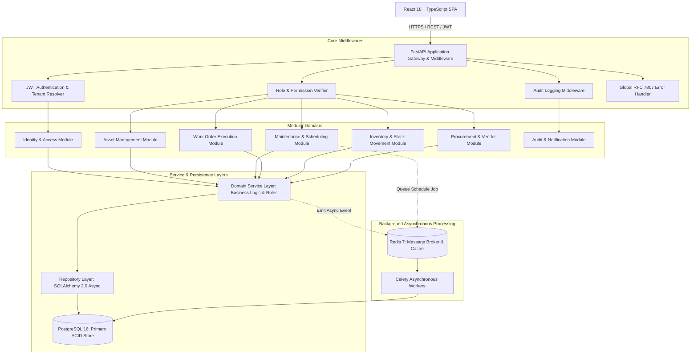

# OpsPilot – Modular Monolith System Architecture

## 1. Executive Summary & Domain Context

**OpsPilot** is an enterprise-grade operations, asset maintenance, and inventory management platform tailored for industrial enterprises. The reference implementation models a textile manufacturing enterprise headquartered in **Coimbatore, Tamil Nadu**, with operational facilities distributed across **Tiruppur** (Apparel Warehouse & Logistics Hub), **Chennai** (Corporate Headquarters), **Madurai** (Regional Service Center), and **Salem** (Spinning Machinery Spare Parts Store).

The system enforces multi-location, tenant-isolated operations with role-based access control (RBAC), end-to-end work order lifecycles, preventive maintenance automation, real-time spare parts inventory tracking, and purchase order fulfillment with audit trails.

---

## 2. Architectural Blueprint: Modular Monolith

OpsPilot adopts a **Modular Monolith** architecture. While running within a single unified backend runtime (FastAPI) and single frontend single-page application (React + Vite), business domains are strictly decoupled behind high-cohesion, low-coupling module boundaries.

### Architectural Advantages for OpsPilot
1. **Zero Distributed Complexity**: Avoids premature distributed transaction challenges (Saga patterns, partial 2PC failures) while preserving strict domain boundaries.
2. **Atomic Business Transactions**: Work order spare part consumption and inventory movements execute within ACID-compliant PostgreSQL transactions.
3. **Extraction Readiness**: If an individual domain (such as Telemetry/Preventive Scheduling or Inventory Management) needs to scale independently later, its decoupled service and repository interfaces can be extracted into an independent microservice with minimal refactoring.
4. **Interview Explanability**: Crystal-clear layered mental model easily articulated by engineering graduates and senior architects alike.



---

## 3. Layered Separation of Concerns

Each module follows a strict 4-tier clean architecture:

1. **Router / API Layer (`api/v1/`)**:
   - HTTP request binding, route declaration, status codes.
   - Pydantic schema validation for request payloads and response serialization.
   - Dependency injection of database sessions and authenticated user context.
   - **Zero business logic** permitted in this layer.

2. **Service Layer (`services/`)**:
   - Pure domain logic, workflow orchestration, and business rule evaluation.
   - Multi-step transactional boundaries (e.g., verifying stock availability, deducting stock, recording stock movement, and attaching part to work order in a single atomic commit).
   - Authorization checks against fine-grained entity permissions.

3. **Repository / Data Access Layer (`repositories/`)**:
   - Explicit SQLAlchemy 2.0 query construction (`select`, `where`, `join`, `with_for_update`).
   - Abstracted filtering, pagination, and multi-tenant isolation (`where(Model.company_id == current_user.company_id)`).
   - No direct HTTP or framework-specific concepts.

4. **Model Layer (`models/`)**:
   - SQLAlchemy Declarative Models defining tables, column types, constraints, foreign keys, and relationship cascades.

---

## 4. Multi-Tenant Data Isolation Strategy

1. **Logical Tenant Isolation**: Every operational table contains a `company_id: UUID` foreign key referencing `companies(id)`.
2. **Contextual Enforcement**: The authenticated user's JWT payload securely injects `company_id`. Repository base queries automatically enforce `company_id` matching. No request can query or mutate cross-company data.
3. **Multi-Location Scoping**: Within a single company, users (such as inventory executives or maintenance technicians) are assigned primary `company_locations(id)`. Access to location-specific stock or work orders is validated at the service layer.

---

## 5. User Roles and RBAC Matrix

OpsPilot features 5 distinct operational roles with fine-grained permissions:

| Permission Domain | Company Admin | Operations Manager | Maintenance Technician | Inventory Executive | General Employee |
| :--- | :---: | :---: | :---: | :---: | :---: |
| **User & RBAC Mgmt** | Full | Read Only | None | None | None |
| **Company & Locations** | Full | Read Only | Read Only | Read Only | Read Only |
| **Asset Directory** | Full | Full | Read & Update Status | Read Only | Read Only |
| **Preventive Schedules**| Full | Full | View & Trigger | None | None |
| **Work Orders** | Full | Create, Assign, Approve | View Assigned, Execute | View Parts Req | Report Issue |
| **Spare Parts Inventory**| Full | Read Only | Request Parts | Full Management | None |
| **Purchase Orders & PO**| Full | Approve PO | None | Create PO, Receive GRN| None |
| **Audit Logs & Reports**| Full | View Operational Logs | None | View Stock Logs | None |

---

## 6. Frontend Architectural Blueprint

The frontend is engineered with React 18, TypeScript (Strict Mode), Vite, Tailwind CSS, and TanStack Query v5.

### Key Architectural Guidelines
- **Feature-Based Modular Structure**: Pages and components are organized by business feature (`assets`, `work-orders`, `inventory`, `maintenance`, `procurement`, `admin`).
- **Server State vs. Client State**:
  - TanStack Query manages asynchronous server state (caching, invalidation, background refetching, optimistic updates).
  - React Hook Form + Zod handles client-side form state validation.
  - Context / Zustand handles local UI state (current location switcher, active theme, sidebar collapse).
- **Enterprise UI Components**: High-density data tables with sorting, filtering, pagination, status badges, contextual drawer panels, and accessible modals.

---

## 7. Folder Structure

```text
OpsPilot/
├── .github/
│   └── workflows/
│       ├── ci-backend.yml
│       └── ci-frontend.yml
├── docs/
│   ├── architecture.md
│   ├── database-schema.md
│   ├── api-specification.md
│   └── workflows.md
├── docker-compose.yml
├── docker-compose.override.yml.example
├── backend/
│   ├── Dockerfile
│   ├── pyproject.toml
│   ├── alembic.ini
│   ├── migrations/
│   │   ├── env.py
│   │   ├── script.py.mako
│   │   └── versions/
│   ├── app/
│   │   ├── __init__.py
│   │   ├── main.py
│   │   ├── core/
│   │   │   ├── config.py
│   │   │   ├── database.py
│   │   │   ├── security.py
│   │   │   ├── exceptions.py
│   │   │   └── logging.py
│   │   ├── models/
│   │   │   ├── base.py
│   │   │   ├── auth.py
│   │   │   ├── organization.py
│   │   │   ├── asset.py
│   │   │   ├── maintenance.py
│   │   │   ├── work_order.py
│   │   │   ├── inventory.py
│   │   │   ├── procurement.py
│   │   │   └── audit.py
│   │   ├── schemas/
│   │   │   ├── common.py
│   │   │   ├── auth.py
│   │   │   ├── organization.py
│   │   │   ├── asset.py
│   │   │   ├── maintenance.py
│   │   │   ├── work_order.py
│   │   │   ├── inventory.py
│   │   │   ├── procurement.py
│   │   │   └── audit.py
│   │   ├── repositories/
│   │   │   ├── base.py
│   │   │   ├── user_repo.py
│   │   │   ├── asset_repo.py
│   │   │   ├── work_order_repo.py
│   │   │   ├── maintenance_repo.py
│   │   │   ├── inventory_repo.py
│   │   │   └── procurement_repo.py
│   │   ├── services/
│   │   │   ├── auth_service.py
│   │   │   ├── asset_service.py
│   │   │   ├── work_order_service.py
│   │   │   ├── maintenance_service.py
│   │   │   ├── inventory_service.py
│   │   │   ├── procurement_service.py
│   │   │   └── audit_service.py
│   │   ├── api/
│   │   │   ├── deps.py
│   │   │   └── v1/
│   │   │       ├── api_router.py
│   │   │       ├── endpoints/
│   │   │       │   ├── auth.py
│   │   │       │   ├── organizations.py
│   │   │       │   ├── assets.py
│   │   │       │   ├── maintenance.py
│   │   │       │   ├── work_orders.py
│   │   │       │   ├── inventory.py
│   │   │       │   ├── procurement.py
│   │   │       │   └── audit.py
│   │   └── workers/
│   │       ├── celery_app.py
│   │       └── tasks/
│   │           ├── maintenance_tasks.py
│   │           └── notification_tasks.py
│   └── tests/
│       ├── conftest.py
│       ├── unit/
│       └── integration/
├── frontend/
│   ├── Dockerfile
│   ├── package.json
│   ├── tsconfig.json
│   ├── vite.config.ts
│   ├── tailwind.config.js
│   ├── src/
│   │   ├── main.tsx
│   │   ├── App.tsx
│   │   ├── index.css
│   │   ├── assets/
│   │   ├── components/
│   │   │   ├── common/
│   │   │   │   ├── Button.tsx
│   │   │   │   ├── Input.tsx
│   │   │   │   ├── Select.tsx
│   │   │   │   ├── Modal.tsx
│   │   │   │   ├── DataTable.tsx
│   │   │   │   ├── Badge.tsx
│   │   │   │   ├── Drawer.tsx
│   │   │   │   └── MetricCard.tsx
│   │   │   ├── layout/
│   │   │   │   ├── Header.tsx
│   │   │   │   ├── Sidebar.tsx
│   │   │   │   ├── LocationSelector.tsx
│   │   │   │   └── AppLayout.tsx
│   │   │   └── feedback/
│   │   │       ├── LoadingSpinner.tsx
│   │   │       ├── EmptyState.tsx
│   │   │       └── ErrorBanner.tsx
│   │   ├── context/
│   │   │   └── AuthContext.tsx
│   │   ├── hooks/
│   │   │   ├── useAuth.ts
│   │   │   └── useDebounce.ts
│   │   ├── lib/
│   │   │   ├── api-client.ts
│   │   │   └── utils.ts
│   │   ├── types/
│   │   │   ├── auth.ts
│   │   │   ├── asset.ts
│   │   │   ├── work-order.ts
│   │   │   ├── inventory.ts
│   │   │   └── procurement.ts
│   │   ├── routes/
│   │   │   ├── index.tsx
│   │   │   └── ProtectedRoute.tsx
│   │   └── pages/
│   │       ├── auth/
│   │       │   └── LoginPage.tsx
│   │       ├── dashboard/
│   │       │   └── OperationsDashboardPage.tsx
│   │       ├── assets/
│   │       │   ├── AssetListPage.tsx
│   │       │   ├── AssetDetailPage.tsx
│   │       │   └── AssetFormPage.tsx
│   │       ├── maintenance/
│   │       │   ├── ScheduleListPage.tsx
│   │       │   └── ScheduleDetailPage.tsx
│   │       ├── work-orders/
│   │       │   ├── WorkOrderListPage.tsx
│   │       │   ├── WorkOrderDetailPage.tsx
│   │       │   └── WorkOrderCreatePage.tsx
│   │       ├── inventory/
│   │       │   ├── InventoryListPage.tsx
│   │       │   ├── StockMovementPage.tsx
│   │       │   └── LowStockAlertPage.tsx
│   │       ├── procurement/
│   │       │   ├── VendorListPage.tsx
│   │       │   ├── PurchaseOrderListPage.tsx
│   │       │   ├── PurchaseOrderDetailPage.tsx
│   │       │   └── GoodsReceiptPage.tsx
│   │       └── admin/
│   │           ├── UsersPage.tsx
│   │           ├── LocationsPage.tsx
│   │           └── AuditLogsPage.tsx
│   └── tests/
│       ├── setup.ts
│       └── components/
└── README.md
```

---

## 8. Development Roadmap

| Phase | Milestone | Deliverables & Focus |
| :--- | :--- | :--- |
| **Phase 1** | **System Architecture & Database Schema** (Current) | Monolith architecture, 24-table DDL/ERD, API contracts, workflows, roadmap. |
| **Phase 2** | **Core Backend Scaffolding & Database Migrations** | FastAPI structure, async SQLAlchemy 2 engine, Alembic migrations for all 24 tables, seed data for Coimbatore headquarters and locations. |
| **Phase 3** | **Identity, RBAC & Organization Services** | Password hashing (Argon2/bcrypt), JWT issuing/revocation, user and location management endpoints, Pytest suites. |
| **Phase 4** | **Asset Registry & Preventive Maintenance Engine** | Asset CRUD, categorization, maintenance schedule calculation, Celery automation for due schedules, Pytest suites. |
| **Phase 5** | **Work Order Management & Parts Consumption** | Work order lifecycle (draft to completed), technician assignment, atomic spare parts requisition, cost tracking. |
| **Phase 6** | **Inventory Management & Procurement Workflows** | Multi-location stock levels, stock movement audits, purchase orders, goods receipt notes (GRN), inventory replenishment. |
| **Phase 7** | **Frontend Foundation & Design System** | Vite + React + Tailwind setup, design system tokens, typography, common UI components (DataTable, Modal, Badge, Drawer). |
| **Phase 8** | **Frontend Application Pages & Integration** | Dashboard, Asset directory, Work orders kanban/table, Inventory manager, PO flow, TanStack query integration. |
| **Phase 9** | **Integration Testing, Dockerization & Verification** | End-to-end integration tests, Docker Compose orchestration (PostgreSQL, Redis, Celery, Backend, Frontend), security audit. |
