# OpsPilot – Database Schema & Entity-Relationship Specification

## 1. Design Principles & Database Rules

1. **Primary Keys**: Every table uses a `UUIDv7` / `UUIDv4` primary key (`id UUID PRIMARY KEY DEFAULT gen_random_uuid()`).
2. **Company-Level Data Isolation**: All tenant-owned operational entities contain `company_id UUID NOT NULL REFERENCES companies(id) ON DELETE CASCADE`.
3. **Monetary & Numeric Precision**: All costs, amounts, and prices utilize `NUMERIC(15, 2)`. Quantities utilize `NUMERIC(12, 2)` to support fractional unit measurements (e.g., meters, kilograms, liters).
4. **Timestamps**: All temporal fields utilize `TIMESTAMP WITH TIME ZONE` (`TIMESTAMPTZ`) defaulted to `CURRENT_TIMESTAMP` in UTC.
5. **Deletion Rules**:
   - `ON DELETE RESTRICT`: Used on critical operational and audit foreign keys (e.g. assets, inventory items, vendors, purchase orders) to prevent accidental loss of operational history and referential integrity violations.
   - `ON DELETE CASCADE`: Used for child entities tightly coupled to their parent (e.g., `role_permissions` $\to$ `roles`, `work_order_comments` $\to$ `work_orders`, `purchase_order_items` $\to$ `purchase_orders`).
   - `ON DELETE SET NULL`: Used for non-critical attribution references (e.g. `users.department_id`, `work_orders.assigned_to`) when an assigned personnel record is decommissioned.
6. **Indexing Strategy**: B-Tree indexes applied on all foreign keys, lookup codes (SKU, asset tag, PO number, work order number), status enums, and timestamp search filters.

---

## 2. Mermaid Entity-Relationship Diagram

```mermaid
erDiagram
    COMPANIES ||--o{ COMPANY_LOCATIONS : "operates at"
    COMPANIES ||--o{ DEPARTMENTS : "houses"
    COMPANIES ||--o{ USERS : "employs"
    COMPANIES ||--o{ ROLES : "defines"
    COMPANIES ||--o{ ASSET_CATEGORIES : "configures"
    COMPANIES ||--o{ ASSETS : "owns"
    COMPANIES ||--o{ MAINTENANCE_SCHEDULES : "schedules"
    COMPANIES ||--o{ WORK_ORDERS : "executes"
    COMPANIES ||--o{ INVENTORY_ITEMS : "stocks"
    COMPANIES ||--o{ VENDORS : "contracts with"
    COMPANIES ||--o{ PURCHASE_ORDERS : "procures through"
    COMPANIES ||--o{ GOODS_RECEIPTS : "receives"
    COMPANIES ||--o{ NOTIFICATIONS : "generates"
    COMPANIES ||--o{ AUDIT_LOGS : "records"

    COMPANY_LOCATIONS ||--o{ USERS : "assigned to"
    COMPANY_LOCATIONS ||--o{ ASSETS : "located at"
    COMPANY_LOCATIONS ||--o{ WORK_ORDERS : "occurs at"
    COMPANY_LOCATIONS ||--o{ INVENTORY_ITEMS : "stored at"
    COMPANY_LOCATIONS ||--o{ PURCHASE_ORDERS : "delivers to"
    COMPANY_LOCATIONS ||--o{ GOODS_RECEIPTS : "received at"
    COMPANY_LOCATIONS ||--o{ STOCK_MOVEMENTS : "from/to"

    DEPARTMENTS ||--o{ USERS : "belongs to"
    DEPARTMENTS ||--o{ ASSETS : "assigned department"

    ROLES ||--o{ USER_ROLES : "assigned via"
    ROLES ||--o{ ROLE_PERMISSIONS : "contains"
    PERMISSIONS ||--o{ ROLE_PERMISSIONS : "granted via"
    USERS ||--o{ USER_ROLES : "holds"

    USERS ||--o{ WORK_ORDERS : "reported / assigned"
    USERS ||--o{ WORK_ORDER_COMMENTS : "authors"
    USERS ||--o{ WORK_ORDER_HISTORY : "changed by"
    USERS ||--o{ MAINTENANCE_HISTORY : "performed by"
    USERS ||--o{ STOCK_MOVEMENTS : "performed by"
    USERS ||--o{ PURCHASE_ORDERS : "created / approved by"
    USERS ||--o{ GOODS_RECEIPTS : "received by"
    USERS ||--o{ NOTIFICATIONS : "targeted to"
    USERS ||--o{ AUDIT_LOGS : "triggered by"

    ASSET_CATEGORIES ||--o{ ASSETS : "classifies"
    ASSETS ||--o{ MAINTENANCE_SCHEDULES : "governed by"
    ASSETS ||--o{ MAINTENANCE_HISTORY : "logged against"
    ASSETS ||--o{ WORK_ORDERS : "serviced in"

    MAINTENANCE_SCHEDULES ||--o{ WORK_ORDERS : "generates"
    MAINTENANCE_SCHEDULES ||--o{ MAINTENANCE_HISTORY : "recorded under"

    WORK_ORDERS ||--o{ WORK_ORDER_COMMENTS : "has"
    WORK_ORDERS ||--o{ WORK_ORDER_HISTORY : "audits state of"
    WORK_ORDERS ||--o{ WORK_ORDER_PARTS : "requires"
    WORK_ORDERS ||--o{ MAINTENANCE_HISTORY : "generates record"

    INVENTORY_ITEMS ||--o{ WORK_ORDER_PARTS : "consumed as"
    INVENTORY_ITEMS ||--o{ STOCK_MOVEMENTS : "transacted in"
    INVENTORY_ITEMS ||--o{ PURCHASE_ORDER_ITEMS : "ordered as"

    STOCK_MOVEMENTS ||--o| WORK_ORDER_PARTS : "fulfills"

    VENDORS ||--o{ PURCHASE_ORDERS : "supplies"
    VENDORS ||--o{ GOODS_RECEIPTS : "delivered from"

    PURCHASE_ORDERS ||--o{ PURCHASE_ORDER_ITEMS : "line items"
    PURCHASE_ORDERS ||--o{ GOODS_RECEIPTS : "fulfilled via"
```



---

## 3. Detailed Data DDL & Schema Specifications

### 1. `companies`
Represents the top-level organization / tenant entity.
```sql
CREATE TABLE companies (
    id UUID PRIMARY KEY DEFAULT gen_random_uuid(),
    name VARCHAR(255) NOT NULL,
    slug VARCHAR(100) NOT NULL UNIQUE,
    code VARCHAR(50) NOT NULL UNIQUE,
    address TEXT NOT NULL,
    city VARCHAR(100) NOT NULL,
    state VARCHAR(100) NOT NULL,
    country VARCHAR(100) NOT NULL DEFAULT 'India',
    postal_code VARCHAR(20) NOT NULL,
    phone VARCHAR(25) NOT NULL,
    email VARCHAR(255) NOT NULL,
    tax_id VARCHAR(50) NOT NULL, -- GSTIN for Indian enterprises
    is_active BOOLEAN NOT NULL DEFAULT TRUE,
    created_at TIMESTAMPTZ NOT NULL DEFAULT CURRENT_TIMESTAMP,
    updated_at TIMESTAMPTZ NOT NULL DEFAULT CURRENT_TIMESTAMP
);
CREATE INDEX idx_companies_code ON companies(code);
CREATE INDEX idx_companies_is_active ON companies(is_active);
```

### 2. `company_locations`
Operating facilities (e.g., Coimbatore Factory, Tiruppur Warehouse, Chennai Corporate, Madurai Service Center, Salem Store).
```sql
CREATE TABLE company_locations (
    id UUID PRIMARY KEY DEFAULT gen_random_uuid(),
    company_id UUID NOT NULL REFERENCES companies(id) ON DELETE CASCADE,
    name VARCHAR(255) NOT NULL,
    code VARCHAR(50) NOT NULL,
    type VARCHAR(50) NOT NULL CHECK (type IN ('factory', 'warehouse', 'corporate_office', 'service_center', 'spare_parts_store')),
    address TEXT NOT NULL,
    city VARCHAR(100) NOT NULL,
    state VARCHAR(100) NOT NULL,
    postal_code VARCHAR(20) NOT NULL,
    is_active BOOLEAN NOT NULL DEFAULT TRUE,
    created_at TIMESTAMPTZ NOT NULL DEFAULT CURRENT_TIMESTAMP,
    updated_at TIMESTAMPTZ NOT NULL DEFAULT CURRENT_TIMESTAMP,
    CONSTRAINT uq_company_location_code UNIQUE (company_id, code)
);
CREATE INDEX idx_company_locations_company_id ON company_locations(company_id);
CREATE INDEX idx_company_locations_type ON company_locations(type);
```

### 3. `departments`
Functional departments within a company.
```sql
CREATE TABLE departments (
    id UUID PRIMARY KEY DEFAULT gen_random_uuid(),
    company_id UUID NOT NULL REFERENCES companies(id) ON DELETE CASCADE,
    name VARCHAR(100) NOT NULL,
    code VARCHAR(50) NOT NULL,
    description TEXT,
    is_active BOOLEAN NOT NULL DEFAULT TRUE,
    created_at TIMESTAMPTZ NOT NULL DEFAULT CURRENT_TIMESTAMP,
    updated_at TIMESTAMPTZ NOT NULL DEFAULT CURRENT_TIMESTAMP,
    CONSTRAINT uq_company_department_code UNIQUE (company_id, code)
);
CREATE INDEX idx_departments_company_id ON departments(company_id);
```

### 4. `users`
Company personnel, authenticating via email and password.
```sql
CREATE TABLE users (
    id UUID PRIMARY KEY DEFAULT gen_random_uuid(),
    company_id UUID NOT NULL REFERENCES companies(id) ON DELETE CASCADE,
    location_id UUID REFERENCES company_locations(id) ON DELETE SET NULL,
    department_id UUID REFERENCES departments(id) ON DELETE SET NULL,
    email VARCHAR(255) NOT NULL,
    password_hash VARCHAR(255) NOT NULL,
    first_name VARCHAR(100) NOT NULL,
    last_name VARCHAR(100) NOT NULL,
    phone VARCHAR(25),
    designation VARCHAR(100),
    is_active BOOLEAN NOT NULL DEFAULT TRUE,
    is_verified BOOLEAN NOT NULL DEFAULT TRUE,
    last_login_at TIMESTAMPTZ,
    created_at TIMESTAMPTZ NOT NULL DEFAULT CURRENT_TIMESTAMP,
    updated_at TIMESTAMPTZ NOT NULL DEFAULT CURRENT_TIMESTAMP,
    CONSTRAINT uq_company_user_email UNIQUE (company_id, email)
);
CREATE INDEX idx_users_company_id ON users(company_id);
CREATE INDEX idx_users_location_id ON users(location_id);
CREATE INDEX idx_users_email ON users(email);
```

### 5. `roles`
RBAC roles scoped to companies (or global system defaults).
```sql
CREATE TABLE roles (
    id UUID PRIMARY KEY DEFAULT gen_random_uuid(),
    company_id UUID REFERENCES companies(id) ON DELETE CASCADE,
    name VARCHAR(100) NOT NULL,
    code VARCHAR(50) NOT NULL,
    description TEXT,
    is_system_role BOOLEAN NOT NULL DEFAULT FALSE,
    created_at TIMESTAMPTZ NOT NULL DEFAULT CURRENT_TIMESTAMP,
    updated_at TIMESTAMPTZ NOT NULL DEFAULT CURRENT_TIMESTAMP,
    CONSTRAINT uq_role_code_per_company UNIQUE (company_id, code)
);
CREATE INDEX idx_roles_company_id ON roles(company_id);
```

### 6. `permissions`
Atomic application privileges.
```sql
CREATE TABLE permissions (
    id UUID PRIMARY KEY DEFAULT gen_random_uuid(),
    code VARCHAR(100) NOT NULL UNIQUE,
    module VARCHAR(50) NOT NULL,
    name VARCHAR(100) NOT NULL,
    description TEXT,
    created_at TIMESTAMPTZ NOT NULL DEFAULT CURRENT_TIMESTAMP
);
CREATE INDEX idx_permissions_module ON permissions(module);
```

### 7. `user_roles`
Mapping table linking users to roles.
```sql
CREATE TABLE user_roles (
    id UUID PRIMARY KEY DEFAULT gen_random_uuid(),
    user_id UUID NOT NULL REFERENCES users(id) ON DELETE CASCADE,
    role_id UUID NOT NULL REFERENCES roles(id) ON DELETE CASCADE,
    assigned_at TIMESTAMPTZ NOT NULL DEFAULT CURRENT_TIMESTAMP,
    assigned_by UUID REFERENCES users(id) ON DELETE SET NULL,
    CONSTRAINT uq_user_role UNIQUE (user_id, role_id)
);
CREATE INDEX idx_user_roles_user ON user_roles(user_id);
CREATE INDEX idx_user_roles_role ON user_roles(role_id);
```

### 8. `role_permissions`
Mapping table linking roles to granular permissions.
```sql
CREATE TABLE role_permissions (
    id UUID PRIMARY KEY DEFAULT gen_random_uuid(),
    role_id UUID NOT NULL REFERENCES roles(id) ON DELETE CASCADE,
    permission_id UUID NOT NULL REFERENCES permissions(id) ON DELETE CASCADE,
    CONSTRAINT uq_role_permission UNIQUE (role_id, permission_id)
);
CREATE INDEX idx_role_permissions_role ON role_permissions(role_id);
```

### 9. `asset_categories`
Taxonomy for industrial machinery, electronic equipment, and tooling.
```sql
CREATE TABLE asset_categories (
    id UUID PRIMARY KEY DEFAULT gen_random_uuid(),
    company_id UUID NOT NULL REFERENCES companies(id) ON DELETE CASCADE,
    name VARCHAR(100) NOT NULL,
    code VARCHAR(50) NOT NULL,
    description TEXT,
    depreciation_method VARCHAR(50) NOT NULL DEFAULT 'straight_line',
    expected_lifetime_months INT NOT NULL DEFAULT 120,
    created_at TIMESTAMPTZ NOT NULL DEFAULT CURRENT_TIMESTAMP,
    updated_at TIMESTAMPTZ NOT NULL DEFAULT CURRENT_TIMESTAMP,
    CONSTRAINT uq_company_asset_cat_code UNIQUE (company_id, code)
);
CREATE INDEX idx_asset_categories_company ON asset_categories(company_id);
```

### 10. `assets`
Physical machines and infrastructure (e.g. Ring Spinning Frames, Air Jet Looms, Steam Boilers).
```sql
CREATE TABLE assets (
    id UUID PRIMARY KEY DEFAULT gen_random_uuid(),
    company_id UUID NOT NULL REFERENCES companies(id) ON DELETE CASCADE,
    location_id UUID NOT NULL REFERENCES company_locations(id) ON DELETE RESTRICT,
    department_id UUID REFERENCES departments(id) ON DELETE SET NULL,
    category_id UUID NOT NULL REFERENCES asset_categories(id) ON DELETE RESTRICT,
    asset_tag VARCHAR(100) NOT NULL,
    name VARCHAR(255) NOT NULL,
    model_number VARCHAR(100),
    serial_number VARCHAR(100),
    status VARCHAR(50) NOT NULL DEFAULT 'operational' CHECK (status IN ('operational', 'in_maintenance', 'out_of_service', 'decommissioned')),
    critical_level VARCHAR(20) NOT NULL DEFAULT 'medium' CHECK (critical_level IN ('low', 'medium', 'high', 'critical')),
    purchase_date DATE NOT NULL,
    purchase_cost NUMERIC(15, 2) NOT NULL,
    warranty_expiry_date DATE,
    expected_lifetime_months INT NOT NULL DEFAULT 120,
    qr_code_url VARCHAR(500),
    created_at TIMESTAMPTZ NOT NULL DEFAULT CURRENT_TIMESTAMP,
    updated_at TIMESTAMPTZ NOT NULL DEFAULT CURRENT_TIMESTAMP,
    CONSTRAINT uq_company_asset_tag UNIQUE (company_id, asset_tag)
);
CREATE INDEX idx_assets_company_id ON assets(company_id);
CREATE INDEX idx_assets_location_id ON assets(location_id);
CREATE INDEX idx_assets_status ON assets(status);
CREATE INDEX idx_assets_critical_level ON assets(critical_level);
```

### 11. `maintenance_schedules`
Preventive maintenance rules governing assets.
```sql
CREATE TABLE maintenance_schedules (
    id UUID PRIMARY KEY DEFAULT gen_random_uuid(),
    company_id UUID NOT NULL REFERENCES companies(id) ON DELETE CASCADE,
    asset_id UUID NOT NULL REFERENCES assets(id) ON DELETE RESTRICT,
    title VARCHAR(255) NOT NULL,
    frequency_type VARCHAR(50) NOT NULL CHECK (frequency_type IN ('daily', 'weekly', 'monthly', 'quarterly', 'yearly', 'running_hours')),
    frequency_interval INT NOT NULL DEFAULT 1,
    last_generated_at TIMESTAMPTZ,
    next_due_date DATE NOT NULL,
    lead_time_days INT NOT NULL DEFAULT 3,
    priority VARCHAR(20) NOT NULL DEFAULT 'medium' CHECK (priority IN ('low', 'medium', 'high', 'urgent')),
    is_active BOOLEAN NOT NULL DEFAULT TRUE,
    created_at TIMESTAMPTZ NOT NULL DEFAULT CURRENT_TIMESTAMP,
    updated_at TIMESTAMPTZ NOT NULL DEFAULT CURRENT_TIMESTAMP
);
CREATE INDEX idx_maint_sched_asset ON maintenance_schedules(asset_id);
CREATE INDEX idx_maint_sched_next_due ON maintenance_schedules(next_due_date, is_active);
```

### 12. `work_orders`
Actionable repair and maintenance tickets.
```sql
CREATE TABLE work_orders (
    id UUID PRIMARY KEY DEFAULT gen_random_uuid(),
    company_id UUID NOT NULL REFERENCES companies(id) ON DELETE CASCADE,
    work_order_number VARCHAR(50) NOT NULL,
    asset_id UUID NOT NULL REFERENCES assets(id) ON DELETE RESTRICT,
    location_id UUID NOT NULL REFERENCES company_locations(id) ON DELETE RESTRICT,
    title VARCHAR(255) NOT NULL,
    description TEXT NOT NULL,
    priority VARCHAR(20) NOT NULL DEFAULT 'medium' CHECK (priority IN ('low', 'medium', 'high', 'urgent')),
    status VARCHAR(30) NOT NULL DEFAULT 'draft' CHECK (status IN ('draft', 'pending_approval', 'approved', 'in_progress', 'on_hold', 'completed', 'cancelled')),
    type VARCHAR(30) NOT NULL CHECK (type IN ('corrective', 'preventive', 'emergency', 'inspection')),
    reported_by UUID NOT NULL REFERENCES users(id) ON DELETE RESTRICT,
    assigned_to UUID REFERENCES users(id) ON DELETE SET NULL,
    maintenance_schedule_id UUID REFERENCES maintenance_schedules(id) ON DELETE SET NULL,
    scheduled_start TIMESTAMPTZ,
    scheduled_end TIMESTAMPTZ,
    actual_start TIMESTAMPTZ,
    actual_end TIMESTAMPTZ,
    estimated_hours NUMERIC(6, 2),
    actual_hours NUMERIC(6, 2),
    total_parts_cost NUMERIC(15, 2) NOT NULL DEFAULT 0.00,
    completion_notes TEXT,
    created_at TIMESTAMPTZ NOT NULL DEFAULT CURRENT_TIMESTAMP,
    updated_at TIMESTAMPTZ NOT NULL DEFAULT CURRENT_TIMESTAMP,
    CONSTRAINT uq_company_work_order_number UNIQUE (company_id, work_order_number)
);
CREATE INDEX idx_work_orders_company_id ON work_orders(company_id);
CREATE INDEX idx_work_orders_asset_id ON work_orders(asset_id);
CREATE INDEX idx_work_orders_status ON work_orders(status);
CREATE INDEX idx_work_orders_assigned_to ON work_orders(assigned_to);
```

### 13. `work_order_comments`
Discussion and shift handoff notes on work orders.
```sql
CREATE TABLE work_order_comments (
    id UUID PRIMARY KEY DEFAULT gen_random_uuid(),
    work_order_id UUID NOT NULL REFERENCES work_orders(id) ON DELETE CASCADE,
    user_id UUID NOT NULL REFERENCES users(id) ON DELETE RESTRICT,
    comment_text TEXT NOT NULL,
    is_internal_note BOOLEAN NOT NULL DEFAULT FALSE,
    created_at TIMESTAMPTZ NOT NULL DEFAULT CURRENT_TIMESTAMP,
    updated_at TIMESTAMPTZ NOT NULL DEFAULT CURRENT_TIMESTAMP
);
CREATE INDEX idx_wo_comments_wo ON work_order_comments(work_order_id);
```

### 14. `work_order_history`
State transitions and lifecycle audit trail.
```sql
CREATE TABLE work_order_history (
    id UUID PRIMARY KEY DEFAULT gen_random_uuid(),
    work_order_id UUID NOT NULL REFERENCES work_orders(id) ON DELETE CASCADE,
    changed_by UUID NOT NULL REFERENCES users(id) ON DELETE RESTRICT,
    from_status VARCHAR(30) NOT NULL,
    to_status VARCHAR(30) NOT NULL,
    change_reason TEXT,
    metadata_json JSONB,
    created_at TIMESTAMPTZ NOT NULL DEFAULT CURRENT_TIMESTAMP
);
CREATE INDEX idx_wo_history_wo ON work_order_history(work_order_id);
```

### 15. `maintenance_history`
Completed maintenance audit records tied to assets and schedules.
```sql
CREATE TABLE maintenance_history (
    id UUID PRIMARY KEY DEFAULT gen_random_uuid(),
    company_id UUID NOT NULL REFERENCES companies(id) ON DELETE CASCADE,
    asset_id UUID NOT NULL REFERENCES assets(id) ON DELETE RESTRICT,
    schedule_id UUID REFERENCES maintenance_schedules(id) ON DELETE SET NULL,
    work_order_id UUID NOT NULL REFERENCES work_orders(id) ON DELETE RESTRICT,
    performed_by UUID NOT NULL REFERENCES users(id) ON DELETE RESTRICT,
    performed_at TIMESTAMPTZ NOT NULL,
    duration_hours NUMERIC(6, 2) NOT NULL,
    notes TEXT,
    result_status VARCHAR(30) NOT NULL CHECK (result_status IN ('passed', 'passed_with_issues', 'failed')),
    created_at TIMESTAMPTZ NOT NULL DEFAULT CURRENT_TIMESTAMP
);
CREATE INDEX idx_maint_hist_asset ON maintenance_history(asset_id);
CREATE INDEX idx_maint_hist_company ON maintenance_history(company_id);
```

### 16. `inventory_items`
Raw materials, spare parts, and consumable supplies across locations.
```sql
CREATE TABLE inventory_items (
    id UUID PRIMARY KEY DEFAULT gen_random_uuid(),
    company_id UUID NOT NULL REFERENCES companies(id) ON DELETE CASCADE,
    location_id UUID NOT NULL REFERENCES company_locations(id) ON DELETE RESTRICT,
    sku VARCHAR(100) NOT NULL,
    item_name VARCHAR(255) NOT NULL,
    description TEXT,
    category VARCHAR(100) NOT NULL,
    unit_of_measure VARCHAR(30) NOT NULL, -- 'pcs', 'kg', 'meter', 'liters'
    unit_cost NUMERIC(15, 2) NOT NULL,
    current_stock NUMERIC(12, 2) NOT NULL DEFAULT 0.00,
    minimum_stock_alert NUMERIC(12, 2) NOT NULL DEFAULT 5.00,
    reorder_quantity NUMERIC(12, 2) NOT NULL DEFAULT 20.00,
    bin_rack_location VARCHAR(100),
    is_active BOOLEAN NOT NULL DEFAULT TRUE,
    created_at TIMESTAMPTZ NOT NULL DEFAULT CURRENT_TIMESTAMP,
    updated_at TIMESTAMPTZ NOT NULL DEFAULT CURRENT_TIMESTAMP,
    CONSTRAINT uq_company_location_sku UNIQUE (company_id, location_id, sku)
);
CREATE INDEX idx_inventory_company_loc ON inventory_items(company_id, location_id);
CREATE INDEX idx_inventory_sku ON inventory_items(sku);
```

### 17. `stock_movements`
Immutable ledger recording all additions, issues, scrap, and transfers.
```sql
CREATE TABLE stock_movements (
    id UUID PRIMARY KEY DEFAULT gen_random_uuid(),
    company_id UUID NOT NULL REFERENCES companies(id) ON DELETE CASCADE,
    item_id UUID NOT NULL REFERENCES inventory_items(id) ON DELETE RESTRICT,
    from_location_id UUID REFERENCES company_locations(id) ON DELETE RESTRICT,
    to_location_id UUID REFERENCES company_locations(id) ON DELETE RESTRICT,
    movement_type VARCHAR(50) NOT NULL CHECK (movement_type IN ('goods_receipt', 'work_order_issue', 'transfer', 'return', 'adjustment', 'scrap')),
    quantity NUMERIC(12, 2) NOT NULL,
    unit_cost NUMERIC(15, 2) NOT NULL,
    total_cost NUMERIC(15, 2) NOT NULL,
    reference_type VARCHAR(50) NOT NULL CHECK (reference_type IN ('purchase_order', 'work_order', 'manual_adjustment', 'stock_transfer')),
    reference_id UUID,
    performed_by UUID NOT NULL REFERENCES users(id) ON DELETE RESTRICT,
    notes TEXT,
    created_at TIMESTAMPTZ NOT NULL DEFAULT CURRENT_TIMESTAMP
);
CREATE INDEX idx_stock_movements_item ON stock_movements(item_id);
CREATE INDEX idx_stock_movements_ref ON stock_movements(reference_type, reference_id);
```

### 18. `work_order_parts`
Spare parts requested and issued for work orders.
```sql
CREATE TABLE work_order_parts (
    id UUID PRIMARY KEY DEFAULT gen_random_uuid(),
    work_order_id UUID NOT NULL REFERENCES work_orders(id) ON DELETE CASCADE,
    item_id UUID NOT NULL REFERENCES inventory_items(id) ON DELETE RESTRICT,
    quantity_requested NUMERIC(12, 2) NOT NULL,
    quantity_used NUMERIC(12, 2) NOT NULL DEFAULT 0.00,
    unit_cost NUMERIC(15, 2) NOT NULL,
    total_cost NUMERIC(15, 2) NOT NULL,
    stock_movement_id UUID REFERENCES stock_movements(id) ON DELETE SET NULL,
    status VARCHAR(30) NOT NULL DEFAULT 'requested' CHECK (status IN ('requested', 'approved', 'issued', 'returned')),
    created_at TIMESTAMPTZ NOT NULL DEFAULT CURRENT_TIMESTAMP,
    updated_at TIMESTAMPTZ NOT NULL DEFAULT CURRENT_TIMESTAMP
);
CREATE INDEX idx_wo_parts_wo ON work_order_parts(work_order_id);
CREATE INDEX idx_wo_parts_item ON work_order_parts(item_id);
```

### 19. `vendors`
Approved suppliers for machinery components and raw materials.
```sql
CREATE TABLE vendors (
    id UUID PRIMARY KEY DEFAULT gen_random_uuid(),
    company_id UUID NOT NULL REFERENCES companies(id) ON DELETE CASCADE,
    vendor_code VARCHAR(50) NOT NULL,
    name VARCHAR(255) NOT NULL,
    contact_person VARCHAR(100),
    email VARCHAR(255) NOT NULL,
    phone VARCHAR(25) NOT NULL,
    address TEXT NOT NULL,
    city VARCHAR(100) NOT NULL,
    state VARCHAR(100) NOT NULL,
    gstin_tax_id VARCHAR(50) NOT NULL,
    payment_terms_days INT NOT NULL DEFAULT 30,
    rating NUMERIC(3, 2) DEFAULT 5.00,
    is_active BOOLEAN NOT NULL DEFAULT TRUE,
    created_at TIMESTAMPTZ NOT NULL DEFAULT CURRENT_TIMESTAMP,
    updated_at TIMESTAMPTZ NOT NULL DEFAULT CURRENT_TIMESTAMP,
    CONSTRAINT uq_company_vendor_code UNIQUE (company_id, vendor_code)
);
CREATE INDEX idx_vendors_company_id ON vendors(company_id);
```

### 20. `purchase_orders`
Procurement contracts issued to vendors.
```sql
CREATE TABLE purchase_orders (
    id UUID PRIMARY KEY DEFAULT gen_random_uuid(),
    company_id UUID NOT NULL REFERENCES companies(id) ON DELETE CASCADE,
    po_number VARCHAR(50) NOT NULL,
    vendor_id UUID NOT NULL REFERENCES vendors(id) ON DELETE RESTRICT,
    location_id UUID NOT NULL REFERENCES company_locations(id) ON DELETE RESTRICT,
    order_date DATE NOT NULL,
    expected_delivery_date DATE NOT NULL,
    status VARCHAR(30) NOT NULL DEFAULT 'draft' CHECK (status IN ('draft', 'submitted', 'approved', 'partially_received', 'received', 'cancelled')),
    subtotal_amount NUMERIC(15, 2) NOT NULL DEFAULT 0.00,
    tax_amount NUMERIC(15, 2) NOT NULL DEFAULT 0.00,
    total_amount NUMERIC(15, 2) NOT NULL DEFAULT 0.00,
    notes TEXT,
    created_by UUID NOT NULL REFERENCES users(id) ON DELETE RESTRICT,
    approved_by UUID REFERENCES users(id) ON DELETE SET NULL,
    created_at TIMESTAMPTZ NOT NULL DEFAULT CURRENT_TIMESTAMP,
    updated_at TIMESTAMPTZ NOT NULL DEFAULT CURRENT_TIMESTAMP,
    CONSTRAINT uq_company_po_number UNIQUE (company_id, po_number)
);
CREATE INDEX idx_po_company_id ON purchase_orders(company_id);
CREATE INDEX idx_po_vendor_id ON purchase_orders(vendor_id);
CREATE INDEX idx_po_status ON purchase_orders(status);
```

### 21. `purchase_order_items`
Individual line items on purchase orders.
```sql
CREATE TABLE purchase_order_items (
    id UUID PRIMARY KEY DEFAULT gen_random_uuid(),
    po_id UUID NOT NULL REFERENCES purchase_orders(id) ON DELETE CASCADE,
    item_id UUID NOT NULL REFERENCES inventory_items(id) ON DELETE RESTRICT,
    quantity_ordered NUMERIC(12, 2) NOT NULL,
    quantity_received NUMERIC(12, 2) NOT NULL DEFAULT 0.00,
    unit_price NUMERIC(15, 2) NOT NULL,
    total_price NUMERIC(15, 2) NOT NULL,
    tax_rate NUMERIC(5, 2) NOT NULL DEFAULT 18.00, -- GST %
    created_at TIMESTAMPTZ NOT NULL DEFAULT CURRENT_TIMESTAMP,
    updated_at TIMESTAMPTZ NOT NULL DEFAULT CURRENT_TIMESTAMP
);
CREATE INDEX idx_po_items_po ON purchase_order_items(po_id);
CREATE INDEX idx_po_items_item ON purchase_order_items(item_id);
```

### 22. `goods_receipts`
Verification and intake of vendor shipments (Goods Receipt Note / GRN).
```sql
CREATE TABLE goods_receipts (
    id UUID PRIMARY KEY DEFAULT gen_random_uuid(),
    company_id UUID NOT NULL REFERENCES companies(id) ON DELETE CASCADE,
    grn_number VARCHAR(50) NOT NULL,
    po_id UUID NOT NULL REFERENCES purchase_orders(id) ON DELETE RESTRICT,
    vendor_id UUID NOT NULL REFERENCES vendors(id) ON DELETE RESTRICT,
    location_id UUID NOT NULL REFERENCES company_locations(id) ON DELETE RESTRICT,
    receipt_date DATE NOT NULL,
    invoice_number VARCHAR(100) NOT NULL,
    invoice_date DATE NOT NULL,
    received_by UUID NOT NULL REFERENCES users(id) ON DELETE RESTRICT,
    status VARCHAR(30) NOT NULL DEFAULT 'inspecting' CHECK (status IN ('inspecting', 'accepted', 'partially_accepted', 'rejected')),
    notes TEXT,
    created_at TIMESTAMPTZ NOT NULL DEFAULT CURRENT_TIMESTAMP,
    updated_at TIMESTAMPTZ NOT NULL DEFAULT CURRENT_TIMESTAMP,
    CONSTRAINT uq_company_grn_number UNIQUE (company_id, grn_number)
);
CREATE INDEX idx_goods_receipts_company ON goods_receipts(company_id);
CREATE INDEX idx_goods_receipts_po ON goods_receipts(po_id);
```

### 23. `notifications`
In-app alerts for system events, stock warnings, and approvals.
```sql
CREATE TABLE notifications (
    id UUID PRIMARY KEY DEFAULT gen_random_uuid(),
    company_id UUID NOT NULL REFERENCES companies(id) ON DELETE CASCADE,
    user_id UUID NOT NULL REFERENCES users(id) ON DELETE CASCADE,
    type VARCHAR(50) NOT NULL CHECK (type IN ('work_order', 'maintenance_due', 'stock_alert', 'po_approval', 'system')),
    title VARCHAR(255) NOT NULL,
    message TEXT NOT NULL,
    link_url VARCHAR(500),
    is_read BOOLEAN NOT NULL DEFAULT FALSE,
    read_at TIMESTAMPTZ,
    created_at TIMESTAMPTZ NOT NULL DEFAULT CURRENT_TIMESTAMP
);
CREATE INDEX idx_notifications_user_read ON notifications(user_id, is_read);
```

### 24. `audit_logs`
Immutable compliance and security record of all critical mutations.
```sql
CREATE TABLE audit_logs (
    id UUID PRIMARY KEY DEFAULT gen_random_uuid(),
    company_id UUID NOT NULL REFERENCES companies(id) ON DELETE CASCADE,
    user_id UUID REFERENCES users(id) ON DELETE SET NULL,
    action VARCHAR(50) NOT NULL CHECK (action IN ('CREATE', 'UPDATE', 'DELETE', 'LOGIN', 'LOGOUT', 'STATUS_CHANGE', 'STOCK_ADJUSTMENT')),
    entity_name VARCHAR(100) NOT NULL,
    entity_id UUID NOT NULL,
    old_values JSONB,
    new_values JSONB,
    ip_address VARCHAR(50),
    user_agent TEXT,
    created_at TIMESTAMPTZ NOT NULL DEFAULT CURRENT_TIMESTAMP
);
CREATE INDEX idx_audit_logs_company_entity ON audit_logs(company_id, entity_name, entity_id);
CREATE INDEX idx_audit_logs_created_at ON audit_logs(created_at);
```
