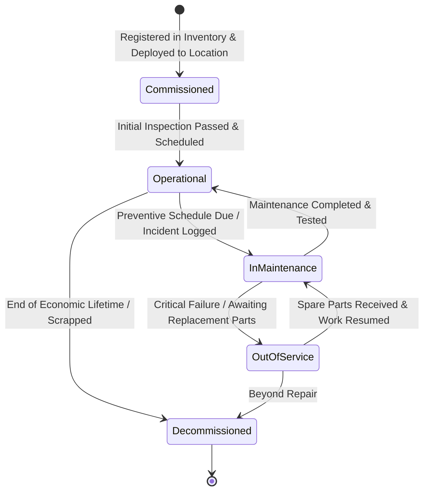
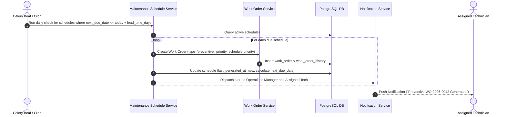
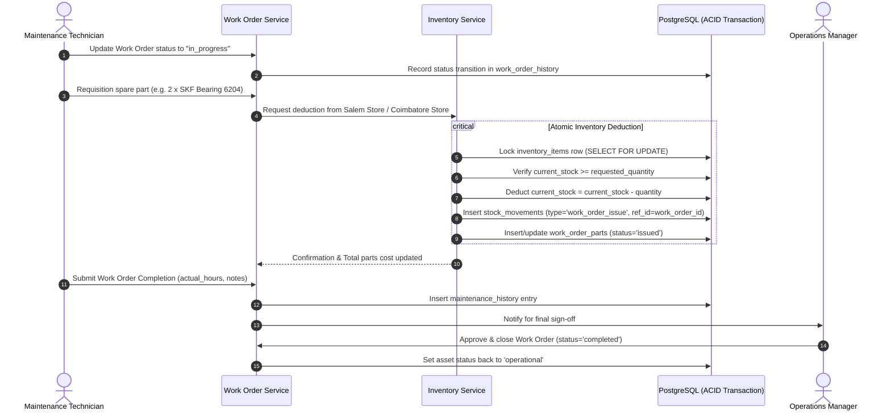
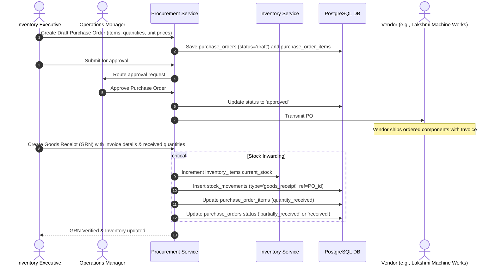
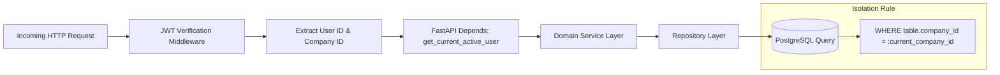

# OpsPilot – Core Business Workflows

## 1. Asset Lifecycle Management Workflow

### Steps & Verification
1. **Commissioning**: Asset created with unique company asset tag, assigned to a specific facility (e.g., Coimbatore Factory - Spinning Mill 1), with initial purchase cost and depreciation schedule.
2. **Preventive Alignment**: Asset linked to one or more maintenance schedules (e.g. Monthly spindle bearing lubrication).
3. **Status Transitions**: State shifts from `operational` to `in_maintenance` when a work order starts, locking the asset status. Upon completion and supervisor sign-off, status returns to `operational`.
4. **Decommissioning**: Retains historical work orders, costs, and audit logs without cascading deletion.

---

## 2. Preventive Maintenance & Auto-Work Order Generation

---

## 3. Work Order Execution & Atomic Spare Parts Requisition

This workflow handles the issue, execution, spare parts deduction, and historical archiving of work orders.

---

## 4. Procurement, Purchase Orders & Goods Receipt Note (GRN)

---

## 5. Security & Multi-Tenant Data Isolation Enforcement

Every query executed by OpsPilot binds `:current_company_id` from the decoded token claims. Even if a malicious or errant payload contains an ID from another tenant, queries fail to find the entity because of the composite predicate `WHERE id = :id AND company_id = :company_id`.
